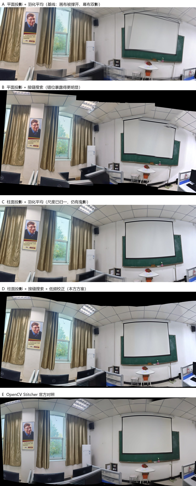
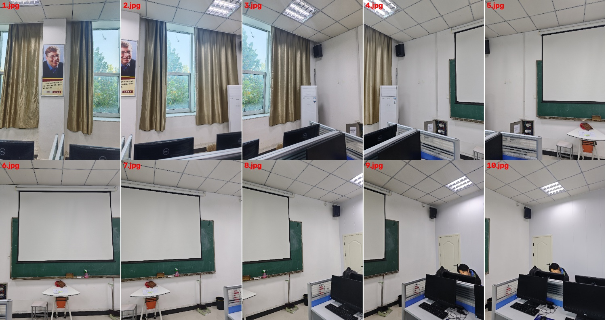
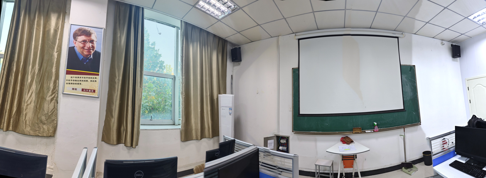
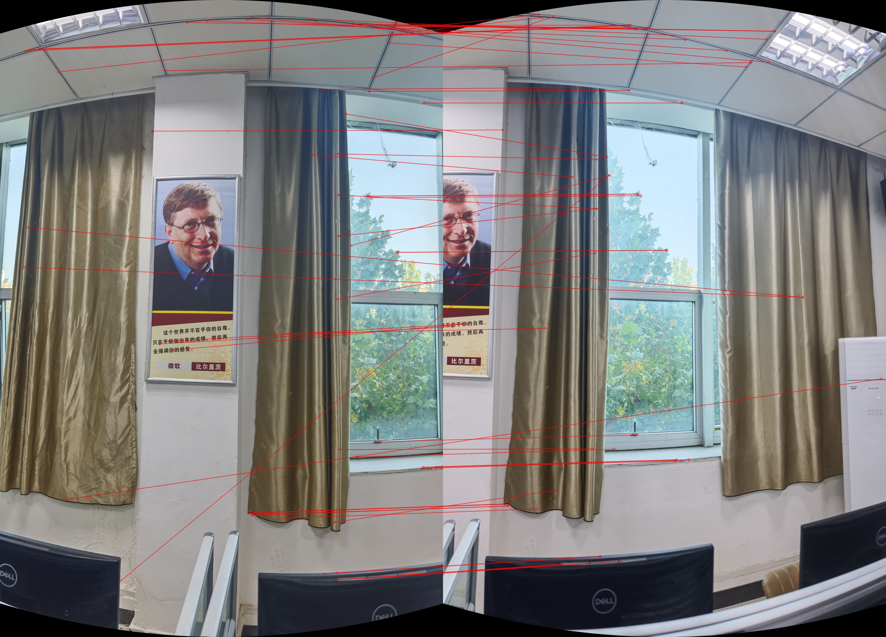

# 多张图片合成全景图

> Python 视觉识别课程任务 · 用 OpenCV 从底层实现拼接链路，与 `cv2.Stitcher` 的结果对照

输入 10 张教室环拍照片，其中第 10 张分辨率偏低未纳入，实际使用 9 张，输出 **5796 × 2004** 的柱面全景图。

本项目的重点不是「跑出图」，而是把 SIFT → 匹配筛选 → RANSAC → 变换累乘 → 接缝融合 → 裁剪这条链路完整写出来，每个环节都能单独导出中间结果，便于分析每一步的作用与失效条件。



| 输入素材 | 最终成品 |
|---|---|
|  |  |

---

## 快速开始

```bash
pip install -r requirements.txt

# 默认参数：柱面投影 + 接缝搜索 + 曝光补偿 + 低频校正
python pano.py --images assets/source

# 出高清图，并导出匹配连线图、逐张 warp 图
python pano.py --images assets/source --scale 0.5 --ratio 0.75 \
    --nfeatures 10000 --dump-parts --output output
```

> **依赖版本注意**：必须用 OpenCV 4.x。OpenCV 5.0 的 `detail_GraphCutSeamFinder` 存在内部断言 bug，本工程使用 4.11.0。

### 复现对照实验

```bash
python pano.py --images assets/source --projection plane       --blend feather --output cmp/A
python pano.py --images assets/source --projection plane       --blend seam    --output cmp/B
python pano.py --images assets/source --projection cylindrical --blend feather --output cmp/C
python pano.py --images assets/source --projection cylindrical --blend seam    --output cmp/D
```

---

## 算法流程

| 步骤 | 内容 | 代码位置 |
|---|---|---|
| 1 | 读图 + 统一分辨率（尺寸不一致会导致柱面焦距各算各的） | `imread_unicode` / `main` |
| 2 | **柱面投影**，把相机旋转转成近似平移 | `cylindrical_project` |
| 3 | SIFT 特征提取 | `PairMatcher.detect` |
| 4 | BFMatcher + Lowe's ratio test 筛选匹配 | `PairMatcher.match` |
| 5 | RANSAC 估计变换矩阵 + 内点最小二乘精化 | `PairMatcher.estimate` |
| 6 | 以中间图为参考平面，左右累乘变换矩阵 | `build_panorama` |
| 7 | 曝光补偿（相邻图亮度增益逐张对齐） | `estimate_pair_gain` |
| 8 | 全局画布计算 + 透视变换 | `build_panorama` |
| 9 | 接缝搜索 + 低频校正融合 | `build_panorama` |
| 10 | 最大内接矩形裁剪，去掉参差边缘 | `largest_inner_rect` |

---

## 四个实测结论

### 1. 柱面投影是必须的

相机绕光心水平旋转时，平面投影下越靠画面边缘拉伸越厉害。实测同一对图像（6→7）：

| 投影方式 | 单应解出的尺度 | 重叠区像素平均绝对差 | 内点率 |
|---|---|---|---|
| 平面投影 | 1.23 ~ 1.36 | 15.1 | 18% ~ 36% |
| 柱面投影 | **0.99 ~ 1.01** | **6.0** | **38% ~ 80%** |

尺度不归一的直接后果：8 个相邻对累乘后画布从 4400 宽撑到 12013 宽，拼接结果不可用。

纯旋转拍摄的正确单应矩阵，其线性部分行列式应恒为 1（`det(KRK⁻¹) = det(R) = 1`），这是判断解是否可信的理论依据。

### 2. 变换模型需要能自适应降级

程序用「尺度是否偏离 1、两列向量是否正交等长」判断 8 自由度单应的解是否可信，不可信时降级到 4 自由度相似变换，避免透视项在病态内点分布上过拟合。

### 3. 融合方式决定有没有鬼影

- **羽化加权平均**：重叠区两图位置略偏时，会平均出「双套轮廓」，即典型鬼影
- **接缝搜索**：沿颜色差异最小的路径切分，硬切换 + 窄带过渡，杜绝鬼影

优先用 `cv2.detail_GraphCutSeamFinder`，遇到 OpenCV 版本 bug 时自动退到 `DpSeamFinder`；接缝在 1/4 分辨率上求解，再把掩码放大回原尺寸（全画布直接跑会吃光内存）。

### 4. 低频校正消除亮度台阶

接缝保住了细节，但两侧曝光残余差异会在白墙、幕布这种平坦区域留下一条亮度台阶。处理办法是同时算一份宽羽化结果，只取它的低频替换接缝结果的低频：

```
结果 = 接缝图 − blur(接缝图, σ) + blur(羽化图, σ)
```

细节来自接缝（不重影），亮度过渡来自羽化（无台阶）。

---

## 实验结果

9 张教室环拍，参考平面取第 5 张：

| 相邻对 | 粗匹配 | RANSAC 内点 | 内点率 | 模型 | 尺度 |
|---|---|---|---|---|---|
| 1→2 | 695 | 353 | 50.8% | homography | 1.037 |
| 2→3 | 417 | 158 | 37.9% | homography | 1.020 |
| 3→4 | 383 | 163 | 42.6% | homography | 1.031 |
| 4→5 | 531 | 325 | 61.2% | homography | 1.048 |
| 5→6 | 458 | 311 | 67.9% | homography | 1.029 |
| 6→7 | 543 | 432 | 79.6% | homography | 0.994 |
| 7→8 | 380 | 280 | 73.7% | homography | 1.009 |
| 8→9 | 475 | 303 | 63.8% | homography | 1.010 |

- 画布 6099×2702，裁剪后成品 **5796×2004**（仓库内图片为裁边版 5470×2004，见「已知局限」）
- 全流程耗时 **77 s**（scale=0.5，nfeatures=10000）
- 对照：`cv2.Stitcher` 输出 5294×2066（仓库内图片为裁边版 4690×2066），耗时 6.4 s

内点率波动的原因是相邻图重叠区内容不同：3→4 那片主要是窗帘和白墙，可分辨特征少。



<sub>绿点连线 = RANSAC 内点，红点连线 = 误匹配。完整过程见 `assets/process/`。</sub>

---

## 已知局限

- **前景视差**：课桌、椅子离相机近，存在真实视差，任何平面/柱面模型都无法同时对齐远景和近景，桌面边缘有轻微断裂。官方 `cv2.Stitcher` 也一样，它通过缩小覆盖范围来回避。
- **曝光残差**：第 9 张欠曝约 42%，提亮后与第 8 张在幕布平坦区仍留有轻微亮度差异，属素材本身的曝光差。
- **素材分辨率不一致**：原始拍摄中第 10 张为 1440×1080，其余 3072×4096；仓库内素材已统一降采样到长边 1600。该张参与拼接需放大插值，反而拉低画质，最终版未纳入。
- **未闭合 360°**：当前覆盖约 180°，首尾未做配准。若要闭合需把首尾两图也做配准并做环形平差。
- **成品图已裁边**：原始输出右下角有一位同学在座，公开前统一裁去画面右侧边缘（手写版 5796→5470，官方对照 5294→4690，五方案对比图每格同比例裁切）。`report.json` 记录的是脚本未裁剪的真实输出尺寸，与仓库内图片宽度相差即为裁切量。
- **素材已作局部模糊**：`assets/source/09.jpg`、`assets/source/10.jpg`、`assets/process/warped_9.jpg` 三张含该同学，已在其头部区域作局部高斯模糊。模糊会改变该处特征点，涉及这两张的匹配结果可能与原始输出有细微差异；成品图对应区域本就在裁切范围外，整体拼接效果不受影响。

## 目录结构

```
panorama-stitching/
├── pano.py                      主程序（734 行，全中文注释）
├── requirements.txt
└── assets/
    ├── source/                  输入素材（降采样到长边 1600）
    ├── result/
│   ├── panorama_manual.jpg     ★ 手写链路成品（裁边后 5470×2004）
│   ├── panorama_opencv.jpg     cv2.Stitcher 对照（裁边后 4690×2066）
    │   ├── five_schemes_compare.jpg 五方案对比拼图
    │   ├── source_overview.jpg     素材总览
    │   └── report.json             关键点/内点/单应矩阵/耗时
    └── process/
        ├── matches_*.jpg          SIFT 匹配连线
        └── warped_*.jpg           逐张 warp 结果
```
